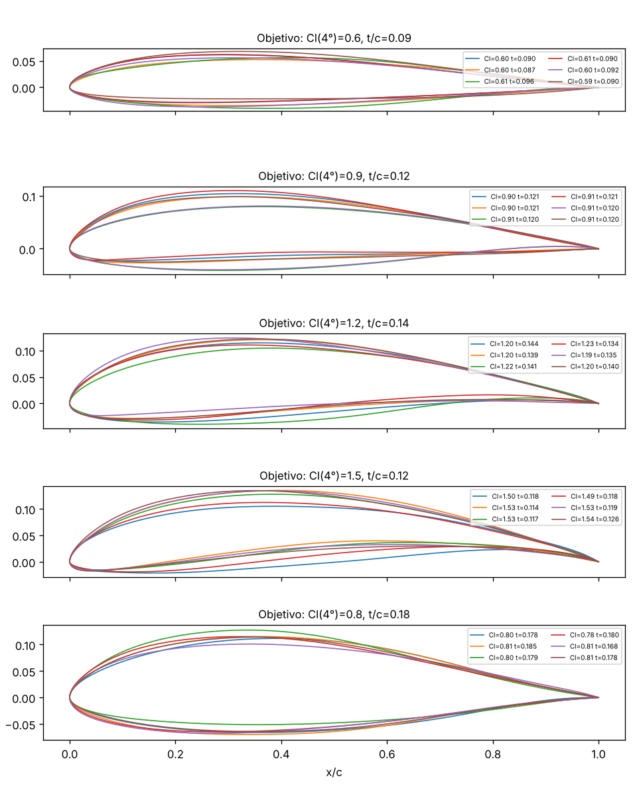

<!-- _class: lead -->
# Dos proyectos para hacer juntos
## Suite aero 🛩️ vs. Barcos oscuros 🛰️

David · noviembre 2026

---

## Por qué un proyecto conjunto

- Un proyecto **serio** de 6 meses pesa más en un CV que 10 tutoriales
- Dos perfiles → más alcance: uno el modelo, otro los datos/dominio
- Objetivo: **repo público + demo + informe corto** (¿preprint?)
- Ritmo realista: 4-6 h/semana cada uno, compatible con clases (y con mi intercambio en India de enero a mayo: trabajo en remoto)

---

## Idea 1 · Suite aero

**Túnel de viento neuronal + generador de alas**

- Red *surrogate*: perfil + Reynolds + ángulo → **Cl, Cd y campos de presión/velocidad en milisegundos** (CFD tarda horas)
- Generador (VAE → difusión): pides Cl, Cd, Re, grosor → **diseña perfiles nuevos**
- Ángulo propio: **efecto suelo en alerones de F1**, con dataset propio en OpenFOAM

---

## Suite aero · cómo

| Paso | Herramienta |
|---|---|
| Geometrías | NACA + UIUC (~1.600 perfiles), parametrización CST |
| Datos rápidos | XFOIL / método de paneles · AirfRANS |
| Datos propios | OpenFOAM (k-ω SST) con suelo |
| Modelos | MLP (coeficientes) · U-Net/GNN (campos) · VAE/difusión |
| Demo | Gradio / Streamlit |

---

## Suite aero · ya hay prototipo

- **Solver propio** (paneles de vórtices): NACA 0012 a 5° → Cl 0,599 ✔
- **Red surrogate**: error medio en Cl **0,002**, **~1.600× más rápida**
- **Generador (CVAE)** sobre 2.090 perfiles reales UIUC: **100 % válidos**, cumple el Cl pedido con error ~0,01-0,03
- Lo que falta es lo interesante: **viscosidad (Cd), campos completos y efecto suelo**

---

## Idea 2 · Barcos oscuros

**Detectar en radar los barcos que apagan el AIS**

- Sentinel-1 (radar, gratis): ve de noche y con nubes; un barco = punto brillante
- Detector entrenado con **xView3-SAR** (Global Fishing Watch + DIU, ~1.000 escenas)
- Cruce con AIS abierto → barcos **sin** transpondedor
- Impacto: pesca ilegal, flota en la sombra, cables submarinos

---

## Barcos oscuros · cómo

| Paso | Herramienta |
|---|---|
| Escenas | Copernicus Data Space (Sentinel-1 GRD, VV/VH) |
| Preproceso | calibración, máscara de tierra, *tiles* (rasterio/GDAL) |
| Detector | U-Net / CenterNet (soluciones ganadoras de xView3 como base) |
| AIS | Danish Maritime Authority, NOAA, Global Fishing Watch |
| Salida | mapa de detecciones "oscuras" (Folium/Leaflet) |

Esqueleto ya funcionando sobre escena sintética (carpeta 08): tiles → CFAR → eslora → cruce AIS.

---

## Hitos

| | Suite aero | Barcos oscuros |
|---|---|---|
| **Mes 1** | dataset XFOIL 10k casos, MLP Cl/Cd | pipeline de escenas, baseline en 20 escenas |
| **Mes 3** | surrogate <5 % error + VAE válido + demo | detector con F1 decente + inferencia en escena nueva |
| **Mes 6** | campos (AirfRANS) + efecto suelo OpenFOAM + generador condicionado | cruce AIS en una zona + mapa de un mes + informe |

---

## Comparativa honesta

| Criterio | Aero | Barcos |
|---|---|---|
| Originalidad | ⭐⭐⭐⭐ | ⭐⭐⭐ |
| Facilidad para arrancar | ⭐⭐⭐⭐ | ⭐⭐⭐⭐ |
| Curva del dominio | ⭐⭐ (CFD) | ⭐⭐⭐ (SAR) |
| Riesgo de no terminar | ⭐⭐⭐ | ⭐⭐⭐⭐ |
| Historia / impacto | ⭐⭐⭐⭐ | ⭐⭐⭐⭐⭐ |
| Ya empezado | ⭐⭐⭐⭐ | ⭐⭐ |

**Casi empate (38 vs 36)** → depende de qué os motive más.

---

## Riesgos y cómo los atajamos

- **Alcance que se dispara** → hito de 3 meses autocontenido, todo lo demás es "bonus"
- **Cómputo** → Colab/Kaggle (GPU gratis), cluster de la uni, simulaciones nocturnas
- **Dominio nuevo** (CFD o SAR) → 2 semanas solo de aprender + reproducir un paper
- **Distancia (India, ene-may)** → repo compartido, *issues*, llamada semanal de 30'

---

## Qué aprendería cada uno

| | Aero | Barcos |
|---|---|---|
| Yo | modelos generativos, surrogates, MLOps | detección de objetos, geoespacial |
| Tú | CFD/OpenFOAM **o** producto/demo | SAR, ingeniería de datos (AIS) |
| Los dos | escribir un informe técnico, colaborar en Git en serio | proyecto con impacto social |

---

## Propuesta

1. **Hoy:** ¿cuál te motiva más? ¿qué parte te pedirías?
2. **2 semanas de *spike*** con la elegida (o con las dos, 1 semana cada una)
3. Decisión con datos → *kick-off*: repo, tablero de tareas, llamada semanal

 

### ¿Te apuntas? 🚀
