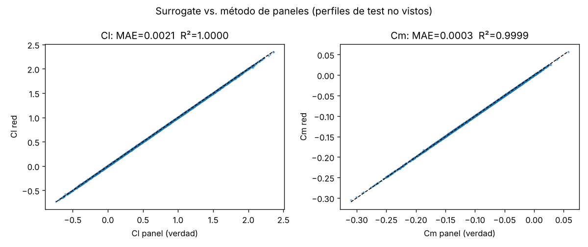
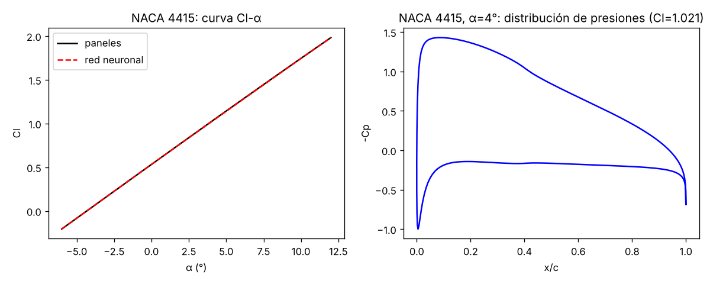

# 06 · Túnel de viento neuronal (prototipo)

Prototipo pequeño **que funciona** de la idea 01 de la Suite aero: un solver aerodinámico propio (método de paneles de vórtices) genera un dataset y una red neuronal aprende a predecir **Cl y Cm** de cualquier perfil a partir de su geometría y del ángulo de ataque, **~1.600 veces más rápido** que el solver.



## Resultados (perfiles de test **no vistos**, separados por perfil)
| | MAE red (MLP) | MAE lineal (Ridge) | Error p95 red | R² red |
|---|---|---|---|---|
| **Cl** | **0,0021** | 0,0127 | 0,0071 | 0,99998 |
| **Cm (c/4)** | **0,0003** | 0,0025 | 0,0008 | 0,99995 |

- Dataset: 1.500 perfiles × 8 ángulos = **12.000 casos** generados en **7,5 s**.
- Velocidad: método de paneles ≈ **2,5 ms/caso**; red ≈ **1,5 µs/caso** en lote → ×1.600.
- Validación del solver: NACA 0012 a 5° → Cl = 0,599 (referencia no viscosa ≈ 0,60); NACA 2412 a 0° → Cl = 0,258, Cm = −0,055 (teoría de perfil delgado: −0,053).



> [!warning] Lectura honesta
> En flujo **no viscoso** el Cl es casi lineal en α y en la curvatura (teoría del perfil delgado), así que una regresión lineal ya acierta un 99,9 %. La red reduce el error ×6, pero el problema de verdad interesante (pérdida, separación, Cd viscoso, efecto suelo) **no está en estos datos**. Es el siguiente paso: XFOIL viscoso → OpenFOAM.

## Cómo usarlo
```bash
cd 06-tunel-viento-neuronal
pip install -r requirements.txt
python generar_dataset.py --perfiles 1500 --angulos 8    # datos/dataset.npz (~8 s)
python entrenar.py                                       # modelo + figuras + resultados.json (~10 s)
python -m pytest -q tests
```
Usar el modelo desde Python (lo usa `07-generador-alas`):
```python
from aero.naca import naca4
from aero.geometry import features
from aero.surrogate import load
import numpy as np
X, Y = naca4(0.04, 0.4, 0.12)
print(load().predict(np.r_[features(X, Y), 5.0]))   # [Cl, Cm] a 5°
```

## Cómo funciona
1. `aero/naca.py` — perfiles NACA de 4 dígitos (espaciado coseno, borde de salida cerrado).
2. `aero/panel.py` — método de paneles de vórtices de intensidad lineal (Kuethe & Chow): matriz de influencia vectorizada con NumPy, condición de Kutta, Cp, Cl por integración de presiones (y por Kutta-Joukowski como comprobación), Cm en c/4. `solve_many` reutiliza la matriz para varios ángulos.
3. `aero/geometry.py` — **representación independiente de la familia**: curvatura y espesor en 16 estaciones fijas (32 números). Así la red sirve para cualquier perfil (UIUC, generados por el VAE), no solo NACA.
4. `generar_dataset.py` — 70 % NACA y 30 % NACA con perturbaciones suaves (modos seno) para que la red vea formas variadas. α ∈ [−6°, 12°].
5. `entrenar.py` — MLP 128-128 (tanh) con escalado de entradas y salidas; partición **por perfil** (GroupShuffleSplit) para no hacer trampa; baseline Ridge.

## Estado del arte (breve)
| Trabajo | Qué hace | Enlace |
|---|---|---|
| Thuerey et al. 2020 (AIAA J.) | U-Net que predice campos RANS (p, u, v) alrededor de perfiles, error ~3 % | https://github.com/thunil/Deep-Flow-Prediction |
| **AirfRANS** (NeurIPS 2022 D&B) | dataset de ~1.000 simulaciones RANS (OpenFOAM) de perfiles NACA, con métricas para surrogates de campos | https://github.com/Extrality/AirfRANS |
| **NeuralFoil** (Sharpe) | red entrenada con decenas de millones de casos XFOIL: Cl, Cd, Cm y capa límite, ~1.000× más rápido que XFOIL | https://github.com/peterdsharpe/NeuralFoil |
| PINNs (Raissi et al. 2019, JCP) | redes que minimizan el residuo de las ecuaciones de Navier-Stokes | https://doi.org/10.1016/j.jcp.2018.10.045 |
| MeshGraphNets (Pfaff et al. ICLR 2021) | GNN sobre la malla CFD: generaliza a geometrías nuevas | https://arxiv.org/abs/2010.03409 |
| FNO (Li et al. ICLR 2021) | operador neuronal de Fourier: aprende el operador solución de la EDP | https://arxiv.org/abs/2010.08895 |
| XFOIL (Drela 1989) | paneles + capa límite acoplada: el estándar rápido para perfiles 2D | https://web.mit.edu/drela/Public/web/xfoil/ |

## Plan para escalar
| Fase | Qué | Datos | Modelo | Criterio de éxito |
|---|---|---|---|---|
| 1 ✅ | Cl, Cm no viscosos | paneles propios (12k) | MLP | MAE Cl < 0,005 |
| 2 | **Cd y pérdida** (viscoso) | XFOIL o NeuralFoil como "profesor" (Re 1e5-1e7) | MLP con Re como entrada | MAE Cd < 5 % fuera de pérdida |
| 3 | **Campos** completos (p, u, v) | AirfRANS | U-Net en malla cartesiana → GNN en la malla original | error relativo de campo < 5 %, Cl/Cd derivados < 5 % |
| 4 | **Efecto suelo** (alerón F1) | OpenFOAM propio: perfil invertido a altura h/c ∈ [0,05, 1], 200-500 casos 2D | fine-tuning del modelo de la fase 3 con h/c como entrada | reproducir el máximo de carga y su caída a h/c pequeño (Zerihan & Zhang 2000) |
| 5 | Demo | — | Gradio | dibujar perfil → Cl/Cd/campo en < 100 ms |

Notas para el efecto suelo: añadir el suelo como pared móvil (*moving ground*, velocidad = flujo libre) es clave; con suelo fijo aparece una capa límite que no existe en pista. El método de paneles se puede extender con el **método de imágenes** (perfil espejo bajo el suelo) para tener una primera versión no viscosa barata antes de OpenFOAM.

## Qué está hecho
- ✅ Solver de paneles validado, generador de datos, entrenamiento, figuras y 8 tests.
- ✅ Modelo guardado (`modelos/surrogate.joblib`) y reutilizable desde otras carpetas.

## Qué falta / siguientes pasos
1. Fase 2 (Cd viscoso): `pip install neuralfoil` o compilar XFOIL; no lo hice esta noche para no gastar tiempo en instalación.
2. Efecto suelo no viscoso con el método de imágenes (≈50 líneas sobre `panel.py`).
3. Pasar a PyTorch cuando haya campos (U-Net); para coeficientes escalares, scikit-learn sobra.

## Decisiones
- **Método de paneles propio en vez de XFOIL**: sin instalación ni binarios y se entiende al 100 %; a cambio, no hay viscosidad (sin Cd ni pérdida). Lo digo claramente arriba.
- **scikit-learn en vez de PyTorch**: PyTorch no estaba instalado y para 33 entradas → 2 salidas un MLP de sklearn entrena en 10 s.
- **Cm en vez de Cd**: un método no viscoso da Cd ≈ 0 (paradoja de d'Alembert), así que predecir Cd no tendría sentido aquí.
- **Partición por perfil**: si un mismo perfil (con otro α) está en train y test, el error sale optimista.

## Fuentes
- Kuethe, A. M. & Chow, C.-Y. *Foundations of Aerodynamics*, 5.ª ed., Wiley, 1998 (método de paneles de vórtices lineales).
- Anderson, J. D. *Fundamentals of Aerodynamics*, 6.ª ed., McGraw-Hill (teoría del perfil delgado).
- Zerihan, J. & Zhang, X. (2000). *Aerodynamics of a single element wing in ground effect*. Journal of Aircraft 37(6).
- Resto de enlaces en la tabla de estado del arte.
