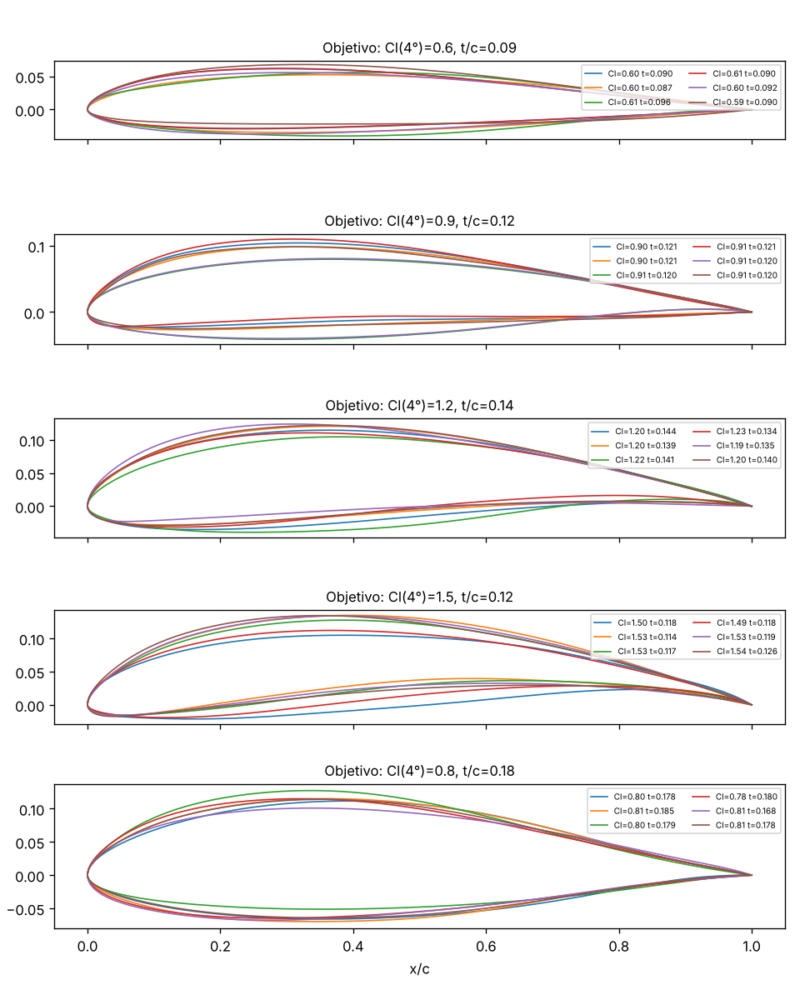
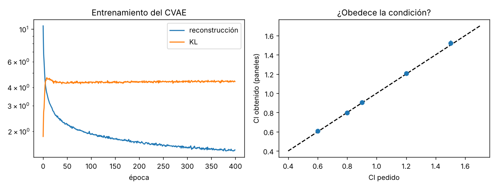
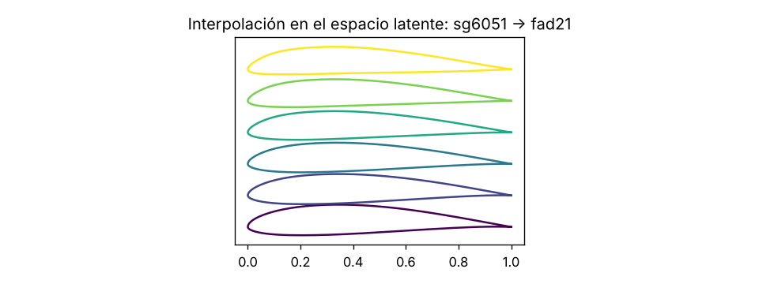

# 07 · Generador de alas (prototipo)

Prototipo de la idea 03 de la Suite aero: un **VAE condicional** (escrito desde cero en NumPy) aprende la forma de **2.090 perfiles reales de la base de datos UIUC** parametrizados con **CST** y genera perfiles **nuevos** con el **Cl** y el **espesor** que le pidas. Cada perfil generado se valida geométricamente y se evalúa con el método de paneles de `06-`.



## Resultados
| Pedido: Cl(α=4°), t/c | Válidos | Cl obtenido (paneles) | Error medio Cl | Error medio t/c |
|---|---|---|---|---|
| 0,6 · 0,09 | 100 % | 0,609 | 0,011 | 0,001 |
| 0,9 · 0,12 | 100 % | 0,905 | 0,011 | 0,001 |
| 1,2 · 0,14 | 100 % | 1,208 | 0,016 | 0,002 |
| 1,5 · 0,12 | 100 % | 1,523 | 0,026 | 0,003 |
| 0,8 · 0,18 | 100 % | 0,796 | 0,014 | 0,002 |

- 60 muestras por condición (temperatura 0,8). Entrenamiento: 1.777 perfiles, **4 s** en CPU.
- Reconstrucción de perfiles de test: error geométrico máximo mediano **0,7 % de la cuerda**.
- **Novedad:** la distancia de cada perfil generado a su vecino más cercano del entrenamiento (0,3-1 % de la cuerda) es del mismo orden que la que hay entre perfiles UIUC entre sí (0,44 %). Es decir: genera variaciones plausibles "entre" perfiles conocidos, no diseños radicalmente nuevos (lo esperable de un VAE con 4 dimensiones latentes).
- **Surrogate de 06 sobre perfiles UIUC** (fuera de su distribución de entrenamiento NACA): MAE Cl = 0,024 (p95 0,058), **×10 peor** que en NACA (0,002). Conclusión: para usar el surrogate en el bucle de diseño hay que reentrenarlo con perfiles UIUC/generados.




## Cómo usarlo
```bash
cd 07-generador-alas
pip install -r requirements.txt
python descargar_uiuc.py       # datos/uiuc_raw/*.dat (no se sube a git)
python preparar_dataset.py     # CST + Cl(4°) con paneles → datos/uiuc_cst.npz (ya incluido)
python entrenar_vae.py         # entrena, genera, valida → figuras/, resultados.json, modelos/cvae.npz
python -m pytest -q tests
```
`entrenar_vae.py` funciona directamente con el `uiuc_cst.npz` incluido (no hace falta descargar nada). Necesita la carpeta `06-tunel-viento-neuronal/` al lado (usa su solver).

## Cómo funciona
1. **Datos**: UIUC Airfoil Coordinates Database. Lector de formatos Selig y Lednicer, normalizado a cuerda 1 (borde de ataque en 0, borde de salida en 1, sin ángulo).
2. **CST (Kulfan)**: cada superficie = $\sqrt{x}(1-x)\cdot\sum_{i=0}^{7}A_i B_{i,7}(x)$ → **16 números por perfil**, ajuste por mínimos cuadrados. Se descartan 84 perfiles (multielemento, cruces, ajuste malo o solver mal condicionado).
3. **Condiciones**: Cl a 4° calculado con el método de paneles de 06 y espesor máximo.
4. **CVAE** (`alas/vae.py`): codificador y decodificador MLP 64-64 tanh, espacio latente de 4 dimensiones, β = 0,3, Adam; retropropagación manual comprobada con diferencias finitas en los tests.
5. **Validación** de cada perfil generado: superficie superior por encima de la inferior en 400 puntos, espesor ≥ 2 %, solver bien condicionado (Cl por presiones ≈ Cl por circulación).

## Qué está hecho
- ✅ Descarga (con plan B), parser, CST, CVAE en NumPy, generación condicionada, validación, evaluación con paneles y surrogate, 3 figuras, 6 tests.

## Qué falta / siguientes pasos
1. **Cd viscoso** como condición (XFOIL/NeuralFoil) → diseño de verdad: "Cl = 1,2 con el mínimo Cd".
2. **Optimización en el espacio latente**: buscar z que minimice Cd/Cl usando el surrogate (gradiente o CMA-ES) y verificar los mejores con el solver.
3. Reentrenar el surrogate de 06 con perfiles UIUC + generados (ver resultado ×10 arriba).
4. Probar un modelo de **difusión** pequeño sobre los 16 coeficientes CST y comparar diversidad/validez con el VAE.
5. Pasar a PyTorch cuando esté disponible (el CVAE NumPy es didáctico pero no escala).

## Decisiones
- **Plan B de descarga**: la web de UIUC está bloqueada en este entorno (403 del proxy). Uso la copia de la base de datos que incluye el paquete `aerosandbox` (licencia MIT) en PyPI: se descarga la *wheel* sin instalarla y se extraen los `.dat`. En tu ordenador `descargar_uiuc.py` intentará primero la web oficial.
- **VAE en NumPy** porque PyTorch no se podía instalar aquí. Ventaja: ves la retropropagación del VAE (*reparameterization trick*) entera, útil para entenderlo.
- **CST de orden 7** (8 coeficientes por cara): error de ajuste < 0,15 % de la cuerda en el 99 % de los perfiles; más orden = más oscilaciones al generar.
- **Cl a 4°** como condición porque el solver es no viscoso: no tiene sentido condicionar en Cd todavía.
- **Borde de salida cerrado** en los generados (simplifica el solver); los perfiles reales con borde grueso se aproximan.

## Fuentes
- UIUC Airfoil Coordinates Database (M. Selig): https://m-selig.ae.illinois.edu/ads/coord_database.html
- AeroSandbox (P. Sharpe, MIT): https://github.com/peterdsharpe/AeroSandbox
- Kulfan, B. (2008). *Universal parametric geometry representation method*. Journal of Aircraft 45(1), 142-158.
- Kingma & Welling (2014). *Auto-Encoding Variational Bayes*. https://arxiv.org/abs/1312.6114
- Sohn et al. (2015). *Learning Structured Output Representation using Deep Conditional Generative Models* (CVAE). NeurIPS.
- Chen, W. et al. (2020). *Airfoil design parameterization and optimization using Bézier GAN*. AIAA Journal. https://arxiv.org/abs/1808.08871
