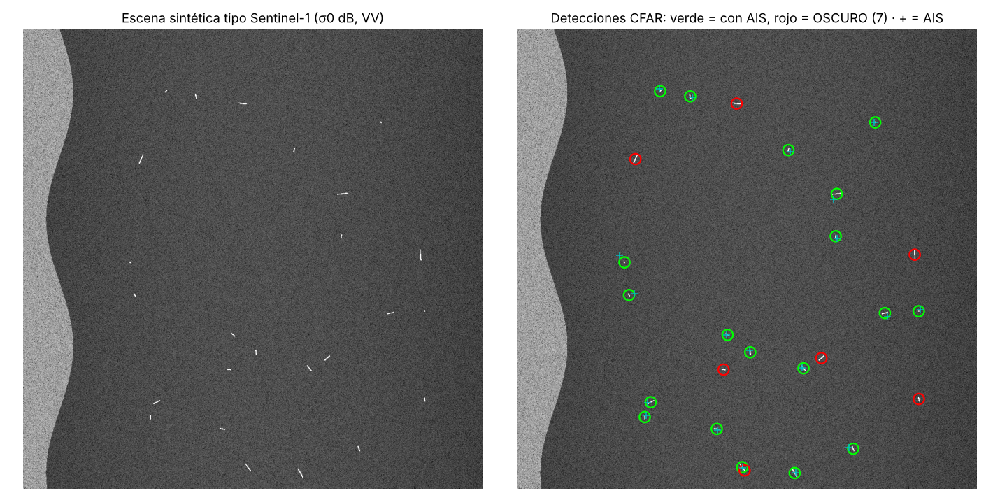

# 08 · Barcos oscuros: dossier técnico + demo funcional

Dossier de la idea 43 (detectar en radar Sentinel-1 los barcos que apagan el AIS) y **esqueleto de pipeline que ya funciona de extremo a extremo** sobre una escena sintética tipo Sentinel-1: *tiles* → detector CFAR → eslora → cruce con AIS → mapa de barcos oscuros.



## Qué hay
| Fichero | Contenido |
|---|---|
| [DOSSIER.md](DOSSIER.md) | Física del SAR (speckle, VV/VH, ambigüedades), cómo conseguir Sentinel-1 gratis (4 vías), xView3-SAR (qué es, cómo pedirlo, métrica), arquitecturas ganadoras, fuentes AIS abiertas y algoritmo de cruce, ética |
| `sarpipe/synthetic.py` | escena sintética: *clutter* marino con speckle gamma multilook (4,4 *looks*, como GRD IW), costa, 25 barcos de 15-250 m, 30 % sin AIS; AIS con error de posición |
| `sarpipe/detect.py` | troceado en tiles con solape, **CA-CFAR** vectorizado (filtros de caja, O(N)), componentes conexas, eslora por PCA, fusión de duplicados |
| `sarpipe/ais.py` | cruce detección↔AIS con **algoritmo húngaro** y puerta de distancia |
| `demo.py` | demo completa + métricas + figura |

## Resultados de la demo (escena sintética, semilla 0)
| Métrica | Valor |
|---|---|
| Recall | 100 % (25/25 barcos) |
| Precisión | 96 % (1 falsa alarma) |
| Error mediano de eslora | 12 % |
| Barcos oscuros reales / marcados | 6 / 7 (el extra es la falsa alarma) |

> ⚠️ Es una escena **sintética**: el *clutter* real tiene viento, oleaje, ambigüedades de acimut, plataformas, islas y hielo. En datos reales el CFAR clásico tiene bastante peor precisión; por eso las soluciones de xView3 usan CNN. Los números de arriba solo prueban que el pipeline está bien montado.

## Cómo usarlo
```bash
cd 08-barcos-oscuros
pip install -r requirements.txt
python demo.py               # figura en figuras/ y métricas en resultados.json
python -m pytest -q tests    # 5 tests
```

## Qué está hecho
- 💡 Dossier completo.
- ✅ Pipeline esqueleto ejecutable con tests (tiles cubren la escena, tasa de falsa alarma del CFAR < 1e-4 en mar puro, detección en 3 semillas, cruce AIS y puerta).

## Qué falta / siguientes pasos
1. **Datos reales**: descargar 1-2 escenas GRD (Copernicus o Planetary Computer, que permite leer solo un trozo) de una zona con AIS abierto (Dinamarca) y pasar el pipeline. Necesita crear cuenta (no lo hice: regla de la noche).
2. Leer GeoTIFF con `rasterio` y pasar de píxeles a lat/lon (las detecciones ahora están en píxeles).
3. Sustituir el CFAR por una U-Net/CenterNet entrenada con un subconjunto de xView3 (Kaggle/Colab con GPU).
4. Interpolación temporal de AIS y corrección Doppler.

## Decisiones
- **Demo sintética**: no encontré escenas SAR pequeñas descargables sin cuenta desde este entorno (red restringida) y crear cuentas está prohibido esta noche. Una escena sintética con estadística realista permite construir y probar todo el pipeline ya.
- **Guarda del CFAR = 14 px**: con 4 px los barcos largos (>150 m = 15 px) se "comían" su propio umbral y se partían en trozos (11 falsas alarmas). Debe superar la mitad de la eslora máxima.
- **Algoritmo húngaro** en vez de vecino más cercano: evita asignar dos detecciones al mismo AIS cuando hay barcos juntos.

## Fuentes
- Paolo et al. (2022), xView3-SAR, NeurIPS D&B: https://arxiv.org/abs/2206.00897 · reto: https://iuu.xview.us/
- Paolo et al. (2024), *Satellite mapping reveals extensive industrial activity at sea*, Nature 625: https://www.nature.com/articles/s41586-023-06825-8
- ESA Sentinel-1 (guía de usuario): https://sentiwiki.copernicus.eu/web/s1-mission
- Copernicus Data Space Ecosystem: https://dataspace.copernicus.eu
- Crisp, D. J. (2004). *The State-of-the-Art in Ship Detection in Synthetic Aperture Radar Imagery*. DSTO-RR-0272 (CFAR y estadística del clutter).
- Danish Maritime Authority AIS: http://web.ais.dk/aisdata/
