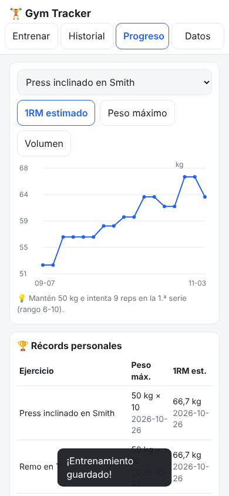

# 10 · Gym Tracker

App web **sin servidor** para registrar tus 5 rutinas de gimnasio desde el móvil: series con peso y repeticiones, histórico, gráfica de progresión por ejercicio, récords personales y **sugerencia de sobrecarga progresiva** en cada ejercicio.



## Cómo usarlo
- **En el ordenador:** doble clic en `index.html`. Funciona sin internet.
- **En el móvil (recomendado):**
  1. Activa GitHub Pages en el repo (*Settings → Pages → Branch: main, carpeta /root*) y abre `https://davidcormar.github.io/Mix_ideas/10-gym-tracker/`.
  2. En el navegador del móvil: *Compartir → Añadir a pantalla de inicio*. Queda como una app.
  3. Los datos se guardan **en ese navegador**: exporta el JSON de vez en cuando (pestaña *Datos*) y guárdalo en Drive/Obsidian.
- **Flujo en el gimnasio:** *Entrenar* → elige rutina → *Empezar* (rellena los pesos de la última sesión) → apunta kg y reps de cada serie y marca ✓ → *Guardar entrenamiento*.
- En la rutina 3, el botón **↔** cambia el curl en polea por curl martillo.
- *Datos → Cargar datos de ejemplo* para ver las gráficas sin haber entrenado aún (8 semanas inventadas; bórralas luego con *Borrar todo*).

Tests:
```bash
cd 10-gym-tracker
node --test tests/*.test.js          # lógica (6 tests)
NODE_PATH=$(npm root -g) node tests/smoke.js   # prueba en Chromium headless (necesita playwright)
```

## Qué está hecho
- ✅ 5 rutinas precargadas con sus series (13 ejercicios compartidos entre rutinas, así el progreso se acumula).
- ✅ Registro por serie, autoguardado del entrenamiento en curso (si cierras la pestaña, no se pierde).
- ✅ Historial con volumen por sesión y borrado.
- ✅ Gráfica por ejercicio: 1RM estimado (Epley), peso máximo o volumen.
- ✅ Récords personales (peso máximo y 1RM estimado con fecha) y aviso de récord al guardar.
- ✅ Sugerencia de **doble progresión** por ejercicio.
- ✅ Exportar/importar JSON (añadir o sustituir). Modo oscuro automático. Diseño móvil.

## Qué falta / siguientes pasos
- Día de **pierna y salto** (no tenía la lista de ejercicios): añade los ejercicios a `EXERCISES` y una rutina en `ROUTINES` dentro de `logic.js`.
- Temporizador de descanso entre series.
- Notas por sesión (sensaciones, sueño) y peso corporal.
- PWA real con *service worker* para instalarla offline.

## Decisiones
- **Sin librerías** (gráfica dibujada en `<canvas>` a mano): funciona offline y con doble clic, sin CDNs.
- **Lógica separada** (`logic.js`, sin DOM) para poder testearla con Node.
- **Doble progresión** porque entrenas al fallo: el número de reps al fallo con un peso fijo es la mejor señal de progreso. Rangos: compuestos 6-10, aislamiento 10-15. Incrementos: 2,5 kg (1,25 kg en laterales en polea, 2 kg en mancuernas). Ajústalos en `EXERCISES` si tus máquinas tienen otros saltos.
- **Epley** para el 1RM estimado: estándar y suficientemente preciso hasta ~10-12 reps; por encima sobreestima, úsalo como tendencia, no como valor absoluto.
