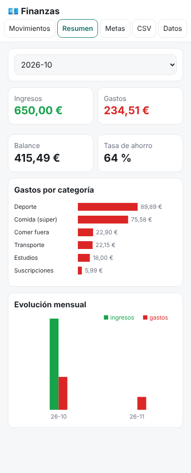

# 11 · Finanzas personales

App web **sin servidor** (doble clic en `index.html`) para controlar ingresos y gastos por categoría, ver el resumen mensual con gráficas, importar el **CSV del banco** y seguir tus **metas de ahorro**: Londres (~300 € para el 19 de noviembre) y Woxsen (~3.500 € para el 6 de enero), con el ahorro mensual que necesitas.



## Cómo usarlo
1. Abre `index.html` (o publícalo con GitHub Pages como el gym tracker y añádelo a la pantalla de inicio del móvil).
2. **Importar del banco:** descarga los movimientos de tu banco en CSV → pestaña *CSV* → ajusta el formato (separador, decimal, formato de fecha, filas de cabecera y número de columna de fecha/concepto/importe) → elige el fichero → revisa la vista previa → *Importar*. La configuración se recuerda y los duplicados se ignoran, así que puedes reimportar el mes entero sin miedo.
   - Prueba con `ejemplos/banco-ejemplo.csv` (formato típico español: `Fecha;Concepto;Importe;Saldo`, `dd/mm/aaaa`, `-12,50`).
   - Si tu banco solo da Excel: ábrelo y *Guardar como → CSV*.
3. Revisa la **categoría** de cada movimiento en *Movimientos* (se asigna sola por palabras clave; puedes cambiarla con el desplegable).
4. *Metas*: apunta cada aportación (lo que separas para el viaje). Verás el % y **cuánto necesitas al mes** para llegar a tiempo.
5. *Datos → Exportar JSON* de vez en cuando (todo vive en el navegador).

Tests:
```bash
cd 11-finanzas
node --test tests/*.test.js                      # 7 tests de lógica
NODE_PATH=$(npm root -g) node tests/smoke.js     # navegador headless (playwright)
```

## Qué está hecho
- ✅ Movimientos manuales y por CSV (formato configurable, comillas, BOM, Latin-1, deduplicado).
- ✅ Categorización automática por palabras clave (supermercados gallegos incluidos: Gadis, Froiz…), editable.
- ✅ Resumen mensual: ingresos, gastos, balance, tasa de ahorro, gastos por categoría y evolución de 12 meses.
- ✅ Metas con barra de progreso, días restantes y ahorro mensual necesario. Precargadas Londres y Woxsen.
- ✅ Exportar/importar JSON. Modo oscuro. Móvil.

## Qué falta / siguientes pasos
- Editar las reglas de categorización desde la interfaz (ahora en `DEFAULT_RULES` de `logic.js`).
- Presupuesto mensual por categoría con alertas.
- Conectar con la skill `revisar-gastos` (01): exporta el JSON y pégaselo a Claude para el análisis.

## Decisiones
- **Nada sale de tu navegador**: sin servidor ni APIs bancarias (exigirían cuentas y claves).
- **Meses fraccionarios** para el ahorro necesario (63 días = 2,07 meses), más realista que redondear.
- **Deduplicado por fecha + importe + concepto**: puede fallar si haces dos compras idénticas el mismo día (raro); a cambio, reimportar es seguro.
- No guarda IBAN ni saldo: solo fecha, concepto, importe y categoría.

> Información general, no asesoramiento financiero.
