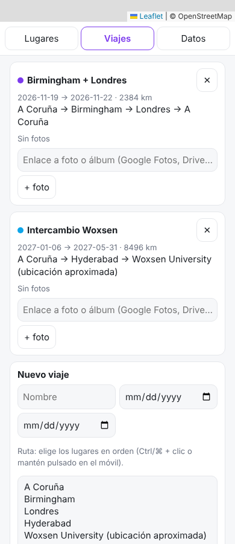

# 12 · Mapa de viajes

App web (doble clic en `index.html`) con **Leaflet + OpenStreetMap** para marcar sitios **visitados** (verde) y **por visitar** (naranja), crear **viajes** con fechas, ruta y enlaces a fotos, y ver los kilómetros de cada ruta. Precargados A Coruña, Birmingham, Londres, Hyderabad y Woxsen, y los viajes de noviembre (UK) y enero (India).



## Cómo usarlo
- Abre `index.html`. Los mapas base (teselas de OSM) necesitan internet; la librería Leaflet va incluida (`vendor/`) y el resto de la app funciona sin conexión.
- **Añadir un lugar:** toca el mapa → nombre → ¿visitado?
- **Corregir posición:** arrastra el marcador (hazlo con **Woxsen**, que está en una posición aproximada).
- **Viajes:** pestaña *Viajes* → nombre, fechas y lugares en orden → *Crear viaje*. Añade enlaces a álbumes de Google Fotos/Drive con *+ foto*.
- **Copia de seguridad:** pestaña *Datos* → exportar/importar JSON.

Tests:
```bash
cd 12-mapa-viajes
node --test tests/*.test.js                  # 5 tests (distancias, validación, ids)
NODE_PATH=$(npm root -g) node tests/smoke.js # Chromium headless
```

## Qué está hecho
- ✅ Mapa con marcadores por estado, rutas punteadas por viaje con km (haversine), popups con notas.
- ✅ Lugares: añadir con clic, arrastrar, marcar visitado, notas, borrar (protegido si está en una ruta).
- ✅ Viajes con fechas, ruta y fotos (enlaces). Estadísticas. Export/import JSON con validación.
- ✅ Funciona sin la librería si falla (modo lista).

## Qué falta / siguientes pasos
- Buscador de lugares (geocodificación con Nominatim de OSM: gratuita, pero con política de uso; mejor añadirlo tú si lo necesitas).
- Importar tus GPX de `02-running-tools` para dibujar tus carreras en el mapa.
- Mapa de calor o "países visitados" (necesitaría un GeoJSON de países).

## Decisiones
- **Leaflet incluido en el repo** (`vendor/leaflet`, licencia BSD-2, 200 KB) en vez de CDN: funciona con doble clic y sin depender de unpkg.
- **Fotos como enlaces**, no subidas: localStorage tiene ~5 MB y las fotos no caben; además así no salen de tu Google Fotos.
- **Woxsen con coordenadas aproximadas** (no pude verificar la ubicación exacta del campus): marcado con ⚠️ para que lo ajustes arrastrando.
- Rutas en línea recta (gran círculo aproximado), suficiente para ver el viaje; no son rutas de carretera.

## Fuentes
- Leaflet: https://leafletjs.com/ · OpenStreetMap: https://www.openstreetmap.org/copyright
- Política de uso de las teselas de OSM: https://operations.osmfoundation.org/policies/tiles/
