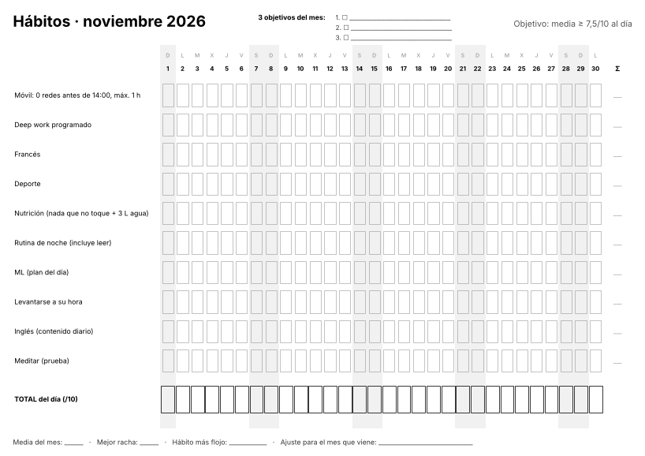
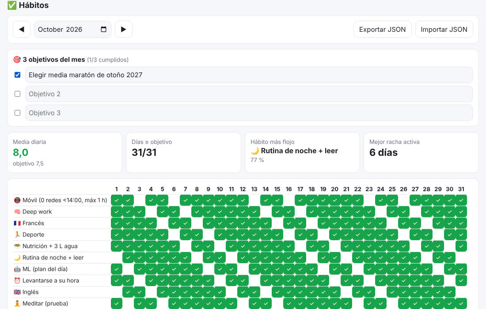

# 15 · Tracker de hábitos

Dos versiones del tracker de tus **10 hábitos de noviembre** (objetivo: media ≥ 7,5 al día), ahora con los **3 objetivos del mes** (idea de tu nota *Habilidades*):

1. **Hoja en papel A4** (PDF) generada para cualquier mes, con los días de la semana, fines de semana sombreados, fila de total diario y pie para la revisión mensual. Ya generadas: `hojas/habitos-2026-11.pdf` y `hojas/habitos-2026-12.pdf`.
2. **Versión digital** (`app/index.html`, doble clic): casillas por día, **media diaria**, días que cumplen el objetivo, **rachas** (actual y mejor) por hábito y **hábito más flojo**. Exportar/importar JSON.




## Cómo usarlo
```bash
cd 15-habitos
pip install -r requirements.txt
python generar_hoja.py 2027 1        # hojas/habitos-2027-01.pdf
```
- Escribe los 3 objetivos del mes en `objetivos_mes` de `habitos.yaml` (o déjalos vacíos y rellénalos a mano en el papel).
- Cambia los hábitos en `habitos.yaml` (la app digital los toma de `app/logic.js` → `HABITS`).
- Imprime el PDF a tamaño real (A4 horizontal).
- Revisión semanal: exporta el JSON (o una foto de la hoja) y usa la skill `revision-habitos-semanal` de `01-claude-skills/`.

Tests:
```bash
python -m pytest -q tests                        # generador de hojas (3)
node --test tests/*.test.js                       # lógica de la app (4)
NODE_PATH=$(npm root -g) node tests/smoke.js      # app en Chromium headless
```

## Qué está hecho
- ✅ Generador A4 (PDF + PNG de vista previa) y hojas de nov/dic 2026.
- ✅ App digital con estadísticas, navegación por meses y backup JSON.

## Qué falta / siguientes pasos
- Puntuación parcial (½) para hábitos a medias, si te resulta útil.
- Gráfica de la media semanal a lo largo de varios meses.

## Decisiones
- **PDF con matplotlib** (sin LaTeX ni navegador): una sola dependencia que ya usas para ML.
- Los emojis se quitan en el papel (la fuente de matplotlib no los tiene) y se mantienen en la app.
- **La racha actual no se rompe** porque hoy aún no hayas marcado el hábito: cuenta hasta ayer si hoy está vacío.
- Los días futuros no cuentan para la media (no te penalizan a mitad de mes).
