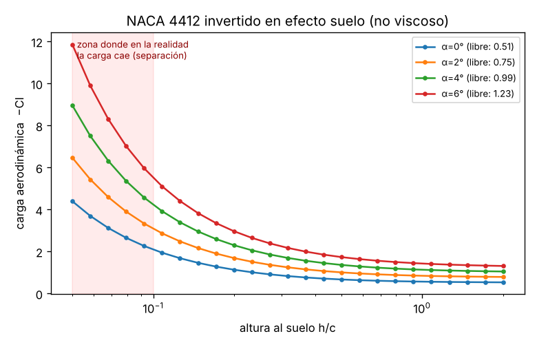
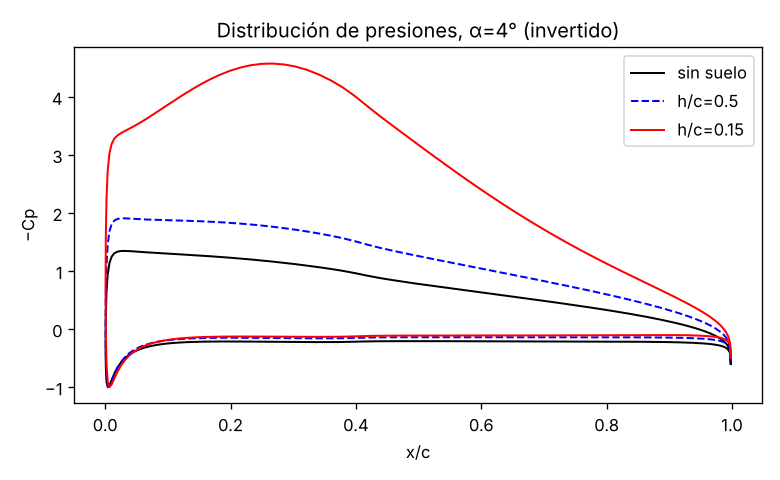

# 20 · Efecto suelo (idea nueva, sigue a la 06)

Extensión del túnel de viento neuronal al **ángulo propio de tu Suite aero: el alerón de F1 cerca del suelo**. Solver de paneles **multicuerpo** + **método de imágenes** (el suelo es un plano de simetría), barrido de altura y un pequeño **surrogate con la altura como entrada**.



## Resultados (NACA 4412 invertido, no viscoso)
| α (morro abajo) | −Cl sin suelo | −Cl a h/c = 0,5 | −Cl a h/c = 0,1 | −Cl a h/c = 0,05 |
|---|---|---|---|---|
| 4° | 0,99 | 1,36 | 4,22 | 8,95 |

- Validación: sin suelo coincide **exactamente** con el solver de 06; lejos del suelo (h/c = 30) recupera el valor libre (<1 %); convergencia de malla <0,5 % (81 vs 161 paneles); un perfil simétrico a 0° es "succionado" hacia el suelo (efecto Venturi), resultado clásico.
- **Surrogate** (MLP, 1.800 casos de 300 perfiles, partición por perfil): error relativo mediano **0,6 %**, p95 **2,9 %**; ~7 ms por caso en el solver frente a ~2 µs en la red.



> [!warning] Lo que este modelo NO captura
> En flujo no viscoso la carga **crece sin límite** al acercarse al suelo. En la realidad (experimentos de Zerihan & Zhang con un alerón de F1) la carga alcanza un **máximo a alturas pequeñas y luego cae**, porque la capa límite de la cara de succión se separa por el fuerte gradiente adverso de presión. Ese máximo es justo lo que un dataset propio en **OpenFOAM** (con suelo móvil) tendría que capturar: es la aportación original del proyecto.

## Cómo usarlo
```bash
cd 20-efecto-suelo
pip install -r requirements.txt
python suelo.py           # tabla rápida de Cl frente a h/c
python experimento.py     # figuras + surrogate (≈20 s)
python -m pytest -q tests # 8 tests
```
Necesita `06-tunel-viento-neuronal/` al lado (reutiliza `aero/`).

## Qué está hecho
- ✅ Solver multicuerpo (sirve también para **alerones de 2 elementos**: ala principal + flap, sin cambiar nada).
- ✅ Imagen especular, colocación con ángulo y altura (al punto más bajo), ala invertida.
- ✅ Barrido, distribución de presiones, surrogate con h/c, 8 tests.

## Qué falta / siguientes pasos
1. **Alerón de 2 elementos** (main + flap) con `solve_bodies` — el solver ya lo admite; falta geometría y validación.
2. Corrección viscosa sencilla (acoplar capa límite tipo Thwaites/Head) para ver el inicio de la separación.
3. Casos OpenFOAM 2D con suelo móvil (simpleFoam, k-ω SST) a 5-10 alturas para calibrar el surrogate.

## Decisiones
- **Rotar la geometría, no el flujo**: con suelo, el suelo debe seguir horizontal.
- **Altura medida al punto más bajo del perfil** (convención habitual en alerones en efecto suelo).
- **Convención de ángulo** para alas invertidas: α > 0 = morro abajo (la incidencia que genera carga).
- Solver propio en lugar de extender XFOIL (XFOIL no admite suelo ni varios cuerpos).

## Fuentes
- Katz, J. (2006). *Race Car Aerodynamics*. Bentley Publishers (efecto suelo y método de imágenes).
- Zerihan, J. & Zhang, X. (2000). *Aerodynamics of a single element wing in ground effect*. Journal of Aircraft 37(6).
- Zhang, X., Toet, W. & Zerihan, J. (2006). *Ground effect aerodynamics of race cars*. Applied Mechanics Reviews 59(1).
- Kuethe & Chow, *Foundations of Aerodynamics* (paneles de vórtices lineales).
