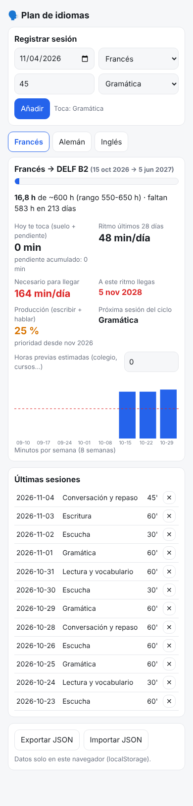

# 21 · Plan de idiomas (idea nueva, de tu *Visión Idiomas*)

App y planes para tus tres idiomas con **tus reglas**: un idioma de estudio principal a la vez, estándar y **suelo innegociable de 30'** (si un día no lo haces, **se suma al siguiente**), los extras (Duolingo, podcasts, series) **no cuentan**, ciclo de 7 sesiones y **prioridad a la producción** desde noviembre.



## Qué hay
| Fichero | Contenido |
|---|---|
| `index.html` (+ `logic.js`) | registro de sesiones y panel por idioma: horas vs. objetivo (FR B2 ~600 h, DE B2 ~525 h, EN C1 ~200 h), **minutos que te tocan hoy** (suelo + pendiente acumulado), ritmo de 28 días, ritmo **necesario** para llegar a la fecha, fecha proyectada, **% de producción** y **próxima sesión del ciclo** |
| [plan-aleman.md](plan-aleman.md) | la **rutina del alemán** que tenías pendiente: fases A1→B2 (jul 2027 → jun-sep 2028), cuentas de horas por escenario, sesión tipo, recursos gratuitos, Goethe B2 |
| [plan-ingles-c1.md](plan-ingles-c1.md) | C1 Advanced tras Woxsen + rutina de inmersión orientada a **entrevistas técnicas en inglés** |

## Cómo usarlo
- Doble clic en `index.html` (o GitHub Pages en el móvil). Registra cada sesión al terminarla; la app te propone el tipo que toca en el ciclo.
- **Horas previas:** pon en el panel una estimación de lo que ya tienes del colegio (sugerencia para el francés: **150-200 h**, porque tu comprensión ya es A2+; como referencia, el A2 suele situarse en torno a 180-200 h guiadas). Sin esa cifra la proyección es demasiado pesimista.
- Revisión trimestral (enero 2027): ¿se cumplió el suelo? Mira "pendiente acumulado" y los días por debajo del suelo.

Tests:
```bash
node --test tests/*.test.js                      # 8 tests (arrastre del suelo, extras, proyección, ciclo, horas previas)
NODE_PATH=$(npm root -g) node tests/smoke.js     # Chromium headless
```

## Lo que dicen los números hoy (ejemplo)
Con 1 h/día desde el 15 de octubre y sin horas previas, llegar a ~600 h el 5 de junio exige **~165 min/día**. Con 180 h previas, ~115 min/día. Es exactamente el "muy ambicioso" de tu visión: la app te enseña cada día si el plan A sigue vivo o toca el plan B (otoño-invierno 2027) **sin drama**.

## Qué está hecho
- ✅ App con 8 tests de lógica + smoke test. ✅ Plan de alemán y de inglés C1.

## Qué falta / siguientes pasos
- Importar un CSV de tus sesiones pasadas si las tienes apuntadas en Obsidian.
- Duplicar la skill `frances-sesion` como `aleman-sesion` en julio de 2027.

## Decisiones
- **Horas como métrica principal** (y no días de racha): es lo que predice si llegas al B2; la racha ya la tienes en Duolingo.
- **Objetivos de horas** en el centro de los rangos que tú mismo apuntaste (FR 550-650, DE 450-600); edítalos en `LANGS` de `logic.js`.
- El inglés no tiene suelo diario: va por inmersión, como decidiste.
