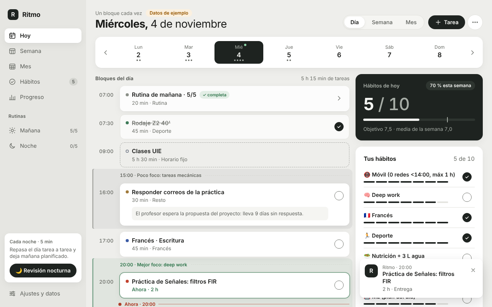
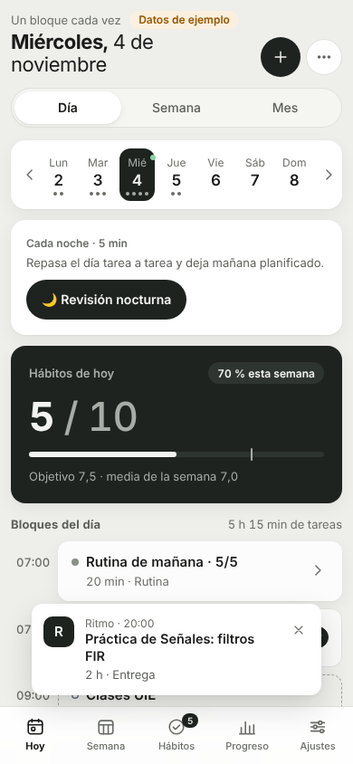

# 26 · Ritmo — Mi organizador de hábitos y rutinas

## 1. Qué es y para qué te sirve

**Ritmo es tu hub del día: planifico, organizo tareas y sigo mis hábitos sin saltar entre apps.** Convierte la skill
`01-claude-skills/organizador-diario` en una herramienta que se abre con doble clic:

- **Orden de prioridad fijo:** evento → entrega (peso × urgencia) → mínimos de deporte y francés → Fase 0 → resto.
- **Franjas de energía:** entreno solo antes de las 9:00 o desde las 19:00; **20:00–23:00 mejor foco** (deep work);
  **15:00–17:00 peor foco** (tareas mecánicas). Ritmo avisa si colocas algo donde no toca.
- **Mínimos innegociables como números:** deporte **suelo 3 · estándar 5** por semana (contando Hábitos, Gym Tracker,
  carreras de Paso y tus tareas hechas, sin contar dos veces la misma sesión) y francés **30' al día con arrastre**
  (lo que no haces hoy se suma mañana, exactamente como en `21-idiomas-plan`).
- **Tus 10 hábitos, objetivo 7,5/día**, compartidos con `15-habitos` (mismo `habitos.v1`): marcas en Ritmo y lo ves
  en la hoja completa, y al revés. Lo mejor de la captura que te gustaba: **rutinas y progreso en un solo sitio**.
- **Revisión nocturna** tarea a tarea que te propone los bloques de mañana (Top 3, lo que se mueve y hábitos en riesgo).
- **Mis apps:** Gym, Idiomas, Finanzas, Paso y Hábitos de un vistazo (solo lectura).

| Escritorio | Móvil |
|---|---|
|  |  |

## 2. Cómo usarlo

- **Doble clic** en `26-ritmo/index.html`. Funciona sin internet, sin instalar nada.
- **En el móvil:** abre `https://davidcormar.github.io/Mix_ideas/26-ritmo/` y usa **«Añadir a pantalla de inicio»**.
- **Primer día:** en *Ajustes y datos* pon tu horario fijo (p. ej. Clases UIE L–V 9:00–14:30) o pulsa
  **«Cargar datos de ejemplo»** para ver un día completo.
- **Atajos:** `n` nueva tarea · `r` revisión nocturna · `t` hoy · `←`/`→` día anterior/siguiente · `Esc` cierra avisos.
- **Exporta el JSON de vez en cuando** (*Ajustes → Exportar JSON*): los datos viven solo en este navegador.
- **Calendario:** *Exportar día/semana (.ics)* se importa en Google Calendar. Las horas van en la zona de tu navegador:
  Europe/Madrid (con horario de verano) en España y Asia/Kolkata en la India, así un bloque de las 20:00 sigue a las 20:00.

**Revisión nocturna en 4 pasos** (botón 🌙, se resalta desde las 20:00; en el móvil, donde no hay barra lateral, Hoy
muestra la tarjeta «Cada noche» de 20:00 a 04:00 hasta que la guardas, y también está en el menú ⋯):

1. **Tarea por tarea:** para cada tarea abierta hasta mañana: *Hecha* (H), *Mañana* (M), *Nueva fecha* (F),
   *Archivar* (A) o *Mantener* (S); «← Atrás» deshace. Con más de 15 tareas, tabla con desplegables.
2. **¿Algo nuevo?:** barre Calendario · Correo · Campus/entregas · Notas de Obsidian y añade lo que salga; el backlog sin
   fecha se puede pasar a mañana.
3. **Mañana:** propuesta de bloques (Hora | Bloque | Tarea | Prioridad) respetando franjas, tope de 6 h de foco y 30' de
   margen. Marca/desmarca y **Aceptar plan**.
4. **Listo:** resumen y **Guardar y terminar** (marca «Revisión nocturna en Ritmo» en tu rutina de noche). Nada se guarda
   antes; el aviso final tiene **Deshacer** durante 8 s.

**Tests** (desde `26-ritmo/`):

```bash
node --test tests/*.test.js
NODE_PATH=$(npm root -g) node tests/smoke.js
```

**Lectura entre apps:** la lectura entre apps funciona cuando comparten origen (p. ej. GitHub Pages: todo cuelga de
`davidcormar.github.io/Mix_ideas/`). En `file://` depende del navegador: Chrome/Edge comparten `localStorage` entre
archivos locales; Firefox aísla cada archivo, así que ahí Ritmo no verá Hábitos, Gym, Idiomas, Finanzas ni Paso.

## 3. Qué está hecho

- ✅ **Hoy:** tira semanal, línea del día con «Ahora», notas, avisos de franja y solapes, bandas de foco (15–17 y 20–23),
  rutinas desplegables, *Sin hora* y *Atrasadas*, tarjeta oscura «Hábitos de hoy X / 10 · % esta semana», lista de
  hábitos con barras de 7 días, mínimos de deporte y francés, 3 objetivos del mes.
- ✅ **Semana** (7 columnas, horas planificadas y resumen), **Mes** (mapa de calor de hábitos, puntos por categoría, ⚑ de
  entregas), **Hábitos** (racha, % 30 días, hábito más flojo con truco, gráfico de 14 días), **Rutinas** (checklist,
  racha, editor), **Progreso** (4 gráficos SVG) y **Mis apps**.
- ✅ Revisión nocturna completa y «Proponer bloques para este día» (desde la hora actual si es hoy).
- ✅ Algoritmo `proposeDay` con el vector normativo de la especificación como test.
- ✅ Marcado automático del hábito al terminar una tarea de deporte/francés o completar una rutina (nunca desmarca).
- ✅ Recordatorios en avisos (y Notificaciones del sistema si las permites), `.ics` del día y de la semana.
- ✅ Exportar/importar JSON (con validación previa), datos de ejemplo deterministas, «Borrar datos de Ritmo» (solo `ritmo.v1`).
- ✅ Modo oscuro, móvil desde 360 px sin scroll horizontal, barra inferior, foco visible y navegación por teclado.
- ✅ 58 tests de lógica (`node --test`) + smoke de Playwright (flujo completo, compatibilidad con 15-hábitos, 360 px, modo oscuro).

## 4. Qué falta / siguientes pasos

- Arrastrar y soltar bloques en la línea del día.
- Partir tareas largas en varios bloques (hoy solo se avisa a partir de 2 h).
- Service worker para avisos en segundo plano (ahora solo con la pestaña abierta).
- Tareas recurrentes (p. ej. «Anki cada día»).
- Que `15-habitos` relea `localStorage` antes de guardar (ver Decisiones) — fuera del alcance de esta carpeta.

## 5. Decisiones

- **`habitos.v1` compartido con lectura-modificación-escritura.** Ritmo nunca usa una copia en caché: cada clic relee
  la clave, aplica solo `setTick` o `setObjective` y la vuelve a guardar compacta (como 15-hábitos). Nunca renombra,
  añade, borra ni reordena hábitos, ni borra meses ni toca otras claves; los campos desconocidos sobreviven intactos. Si
  la clave no es válida aparece un aviso, los botones se desactivan y no se escribe nada. La única «reparación» es
  añadir la lista de hábitos por defecto si falta, porque 15-hábitos se rompe sin ella.
- **Aviso de pestaña antigua de 15-hábitos.** 15-hábitos guarda su objeto entero en cada cambio; si lo tienes abierto
  en otra pestaña a la vez que Ritmo, puede sobrescribir los ticks que hizo Ritmo. Recarga 15-hábitos antes de usarlo
  (o ciérralo mientras usas Ritmo). Ritmo sí escucha el evento `storage` y se actualiza solo.
- **Semántica de idiomas reutilizada.** El francés usa la fórmula de `pending()` de 21-idiomas
  (`p = max(0, p + suelo − hecho)` desde el 15-10-2026, sin contar «extra»); un test la compara con el código real de
  21-idiomas. Si `idiomas.v1` no existe, se cuentan tus tareas de francés hechas en Ritmo desde el primer uso. El suelo
  sale de Ajustes (30' por defecto, igual que 21-idiomas). Igual que 21-idiomas, una entrada mal formada invalida la
  clave entera.
- **Deporte deduplicado con el máximo por día:** `n = max(tick del hábito, gym + carreras, tareas de Ritmo hechas)`.
  La misma sesión apuntada en dos sitios cuenta una vez; dos sesiones reales (gym + carrera) cuentan dos. Paso usa el
  mismo código (sin las tareas de Ritmo), así que sus números coinciden.
- **Deduplicación de Health por la fuente máxima y su límite** (decisión de 27-Paso): Ritmo solo lee los pasos de hoy
  que Paso ya ha calculado; si Paso subestima un día por solaparse dos dispositivos, Ritmo muestra lo mismo.
- **Zancada = 0,415 × altura** y **rampa de verdura de la guía** son decisiones de 27-Paso; Ritmo no las recalcula,
  solo muestra pasos/objetivo y comidas.
- **Sin frameworks ni CDN:** 4 archivos (`index.html`, `styles.css`, `logic.js`, `app.js`), scripts clásicos (no
  `type="module"`, que falla en `file://`), sin fuentes web; el favicon es un `data:` URI.
- **Formato español a mano:** `fmtInt(8420) = "8.420"` (el locale es-ES no agrupa números de 4 cifras), decimales con coma
  y fechas en castellano sin `toLocaleString`. Las fechas se calculan como texto/UTC (seguras con el cambio de hora) y
  nunca con `toISOString()` para el «hoy» local.
- **Lógica pura y testeable:** todo lo que decide (prioridades, franjas, propuesta del día, rachas, ICS, importación)
  vive en `logic.js` sin DOM ni reloj oculto; `app.js` solo pinta y guarda.

**Decisiones propias donde la especificación era ambigua:**

- *Vector de `weekPct`:* el ejemplo «hoy 2026-11-01, 21/30 → 70» no cuadra (el 1-11 es domingo: 7 días × 10 hábitos =
  70 casillas). El test cubre ese caso con 49/70 → 70 % leyendo octubre y noviembre, y el 21/30 → 70 % con la semana
  30-11…2-12 (3 días × 10), que también cruza de mes.
- *Recordatorios fijos:* los avisos de recordatorio se quedan hasta que los cierras (✕ o Esc) en vez de 4 s, para no
  perderlos si no estabas mirando; el resto de avisos dura 4 s (8 s con «Deshacer»). Máximo 3 a la vez.
- *«Mañana» en la revisión* significa el día que se planifica (`reviewDay + 1`); así, una revisión a la 01:30 mueve las
  tareas a hoy, no a pasado mañana. «Hecha» en la revisión apunta `doneOn = reviewDay`.
- *Marcar hecha desde la línea del día* pone `doneOn` = fecha de la tarea si es pasada (si te olvidaste de marcarla
  ayer, cuenta para ayer); si no, hoy.
- *Propuesta del día:* además de reutilizar la tarea de deporte/francés del propio día, reutiliza una atrasada sin
  hora de esa categoría antes de crear una nueva (evita duplicados), y coloca en su franja las tareas explícitas de
  deporte/francés que sobren. Si hoy ya hay deporte hecho o con hora, no propone otro. Al aceptar un bloque de francés
  reutilizado, la tarea toma la duración del bloque.
- *Fuentes del deporte:* «Fuentes: …» lista las apps con datos disponibles en este navegador.
- *Deshacer* restaura `ritmo.v1`; los hábitos marcados automáticamente se quedan (Ritmo nunca desmarca).
- *Datos de ejemplo en Hábitos:* solo si `habitos.v1` falta o no tiene ningún tick, y siempre con `setTick`/`setObjective`
  (si ya tenías tu propia lista de hábitos sin ticks, se respeta; los vínculos Deporte/Francés/Noche se buscan en tu lista).
  El aviso de confirmación lo dice, y Ritmo apunta en `ritmo.v1` exactamente qué ticks añadió: *Ajustes → «Quitar ticks de
  ejemplo de Hábitos»* quita solo esos (lo que marques tú se queda). «Borrar datos de Ritmo» sigue sin tocar `habitos.v1`.
  Mientras haya datos de ejemplo, la cabecera muestra la etiqueta «Datos de ejemplo».
- *Calendario en la zona del navegador:* la especificación fijaba Europe/Madrid, pero de enero a junio de 2027 estarás en
  la India y un bloque de las 20:00 se importaría a las 00:30 del día siguiente. El `.ics` usa la zona del navegador:
  Europe/Madrid (el VTIMEZONE exacto de la especificación) o Asia/Kolkata; en cualquier otra zona, horas «flotantes»
  que Google Calendar coloca en la zona de tu calendario.
- *Avisos abajo a la derecha en escritorio* (la especificación decía abajo a la izquierda): ahí tapaban la tarjeta
  «Cada noche» y el botón de la revisión nocturna. En el móvil siguen centrados sobre la barra inferior.
- *Recordatorios tras suspender el portátil:* al cambiar de día se reinicia la lista de avisos ya enviados, y si la pestaña
  estuvo dormida no se lanzan de golpe los bloques que empezaron hace más de 15 minutos.
- *Contraste AA:* `--ink-3`, `--ok` y `--warn` están algo más oscuros (más claro `--ink-3` en modo oscuro) que en la
  especificación, porque los valores originales daban 2,7–4,2:1 en textos pequeños. Paso usa los mismos valores.
- *Datos propios dañados:* si `ritmo.v1` no se puede leer, el aviso ofrece «Descargar el texto dañado» antes de que el
  siguiente cambio lo sobrescriba. Ritmo no escribe ninguna otra clave (ni siquiera una de prueba).
- *Gráficos* dibujados al ancho real de su tarjeta (se redibujan al cambiar el tamaño de la ventana) para que el texto
  no se deforme.
- *Firmas concretas:* `sportByDay` recibe el objeto `habitos.v1` en `habits` y `ritmoDone` como lista de fechas;
  `frenchStatus(src, …)` recibe `src = { idiomas, tasks }`; `readGym(raw, today)` devuelve `{sessions, thisWeek, last}`;
  `setTick(data, iso, h, on, today)` necesita `today` explícito (sin reloj oculto).
