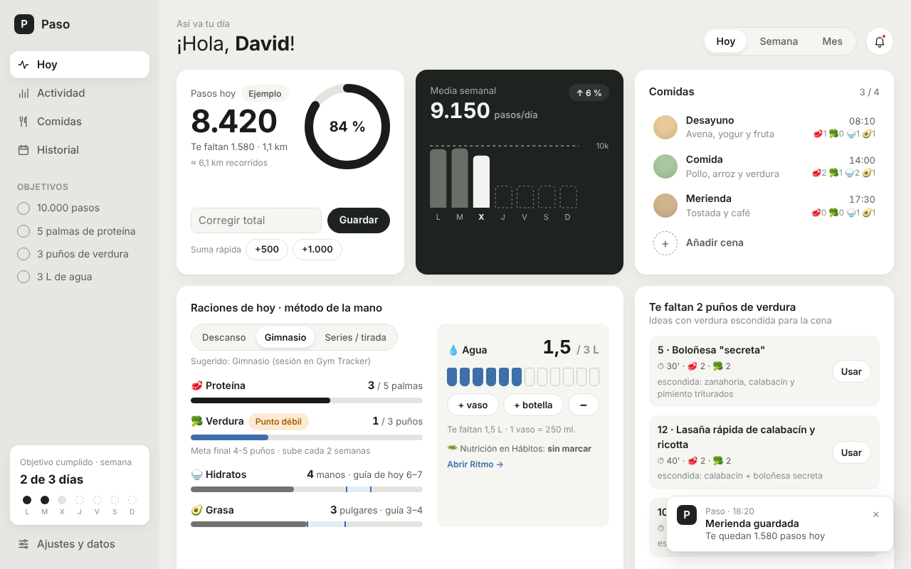
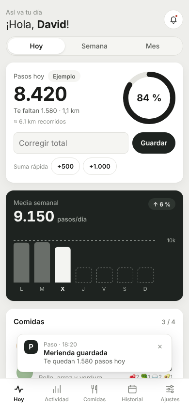

# 27 · Paso — mi tracker de pasos y comidas (sin calorías)

## Qué es y para qué te sirve
Paso junta en una pantalla **tus pasos, tus comidas y tu actividad de la semana**, con un historial visual del mes (lo que más te gustó de la idea original). La diferencia con cualquier app de nutrición: **aquí no se cuentan calorías**. Las comidas se apuntan con el **método de la mano** de tu [guía de raciones](../16-nutricion/guia-raciones.md):

| | Unidad | Tu objetivo |
|---|---|---|
| 🥩 Proteína | palma | **~5 palmas al día** (≈125 g) |
| 🥦 Verdura | puño | **tu punto débil**: rampa de la guía, 2 → 3 → 4 puños, un escalón cada 2 semanas |
| 🍚 Hidratos | mano ahuecada | solo orientativo, según el día: descanso 3–4 · gimnasio 6–7 · series/tirada 6–9 |
| 🥑 Grasa | pulgar | solo orientativo: descanso 3–6 · gimnasio/series 3–4 |
| 💧 Agua | vaso / botella | **3 L** (tu hábito «Nutrición + 3 L agua») |
| 👟 Pasos | — | **10.000** al día |

- La verdura sale marcada como **«Punto débil»** y, mientras te falte, Paso te propone **3 recetas con verdura escondida** de tus [20 recetas](../16-nutricion/recetas.md) para la próxima comida (botón «Usar» = la comida queda rellenada).
- Un día está **cumplido** con 3 de los 4 objetivos (pasos, proteína, verdura, agua); el mapa de calor del mes lo pinta de claro a oscuro.
- Los pasos se escriben a mano en un segundo o se **importan de Apple Health o de un CSV**, para no apuntar nada dos veces.
- Lee (sin tocar nunca) tus entrenos de **Gym Tracker** y el hábito **Deporte** de 15-hábitos, y cuenta tus sesiones de la semana con el **suelo 3 / estándar 5**, con la misma regla que Ritmo.




> Información general para una persona sana y activa, no consejo médico ni dietético. Si quieres algo a medida, un dietista-nutricionista colegiado.

## Cómo usarlo
- **Doble clic en `index.html`.** Funciona sin internet, sin instalar nada (4 ficheros: `index.html`, `styles.css`, `logic.js`, `app.js`).
- **En el móvil:** abre `https://davidcormar.github.io/Mix_ideas/27-paso/` y en Safari → Compartir → **«Añadir a pantalla de inicio»**. Se queda como una app.
- **Primera vez:** en *Ajustes y datos* puedes pulsar «Cargar datos de ejemplo» para verla llena (45 días); luego «Borrar datos de Paso» y empezar con los tuyos.
- **El día a día (30 segundos):**
  1. *Hoy* → «Añadir cena» (la app ya sabe qué comida toca por la hora) → toca **+** en palmas/puños/manos/pulgares, o elige una receta → Guardar. Te avisa: «Cena guardada · te quedan 1.580 pasos hoy».
  2. «+ vaso» / «+ botella» cada vez que bebes.
  3. Los pasos: escribe el total del día y «Guardar», o súmalos con +500 / +1.000.
  4. El tipo de día (Descanso · Gimnasio · Series/tirada) se sugiere solo si hay sesión en Gym Tracker o una carrera de series/tirada; cambia la guía de hidratos y grasa.
- **Importar tus pasos del iPhone (Apple Health):** en el iPhone, **Salud → tu foto (arriba a la derecha) → Exportar todos los datos de salud**. Te da un `export.zip`: pásalo al ordenador, descomprímelo y en *Actividad → Importar pasos → Apple Health* elige `apple_health_export/export.xml`. Se lee por trozos (aunque pese varios GB), eliges las fuentes (iPhone, reloj…) y ves una vista previa antes de «Importar N días». Los días que escribiste a mano no se tocan salvo que marques «Sobrescribir también los días que escribí a mano».
- **CSV:** una fila por día, `fecha,pasos` (también `02/11/2026;9.420`, con o sin cabecera).
- **Atajos de teclado:** `n` nueva comida · `t` hoy · `←`/`→` día anterior/siguiente (semana en *Actividad*, mes en *Historial*) · `Esc` cierra avisos.
- **Exporta el JSON de vez en cuando** (*Ajustes y datos → Exportar JSON*): todo vive en el navegador (`localStorage["paso.v1"]`) y una limpieza del navegador lo borraría.
- **Lectura entre apps:** Paso lee `gymtracker.v1` y `habitos.v1` solo si comparten origen. En GitHub Pages todas las carpetas están bajo `davidcormar.github.io/Mix_ideas/`, así que se ven. En `file://`, **Chrome y Edge** comparten el almacenamiento entre ficheros locales; **Firefox aísla cada fichero** (Paso funciona, pero no verá tus otras apps).

Tests (desde `27-paso/`):
```bash
node --test tests/*.test.js                      # 35 tests de lógica
NODE_PATH=$(npm root -g) node tests/smoke.js     # Chromium headless: recorrido completo + capturas
```

## Qué está hecho
- ✅ **Hoy**: anillo de pasos con %, «Te faltan 1.580 · 1,1 km», tarjeta oscura con la media semanal y el % frente a la semana anterior (7 barras, línea de objetivo), comidas N/4 con hora, descripción y raciones, raciones del día con barras (proteína, verdura «Punto débil», hidratos y grasa con su franja de guía), agua en vasos, ideas de verdura escondida y tira de calor de este mes y el anterior.
- ✅ **Comidas**: comidas del día (editar/borrar), resumen de raciones, tabla «Últimos 7 días» con ✓/✗ y las 20 recetas con filtros.
- ✅ **Actividad**: pasos de la semana y media de 8 semanas (SVG), sesiones de deporte con suelo 3 / estándar 5 (Gym Tracker + carreras + hábito Deporte, sin contar dos veces), registro de carreras/nado, importación de Apple Health (streaming, deduplicación, elección de fuentes) y CSV, pasos de cualquier día.
- ✅ **Historial**: calendario del mes (lunes primero) con nivel 0–4, etiquetas accesibles por día, «Objetivo cumplido N de M días» y % por objetivo (verdura resaltada).
- ✅ **Ajustes y datos**: nombre, objetivo de pasos, altura y zancada, proteína, rampa o meta fija de verdura, agua, vaso/botella, umbral de día cumplido; exportar/importar JSON, datos de ejemplo, borrar (solo `paso.v1`).
- ✅ Campana con lo que falta hoy, avisos (toasts), modo oscuro, móvil desde 360 px sin scroll horizontal, barra de pestañas, foco visible y navegación con teclado.
- ✅ 35 tests de lógica (incluidos los vectores compartidos de deporte con Ritmo y un `export.xml` sintético en `tests/fixtures/`) + smoke test con capturas.

## Qué falta / siguientes pasos
- **Importar fusionando** (merge) una copia JSON en vez de sustituirla entera.
- Leer directamente el **`export.zip`** de Salud (ahora hay que descomprimirlo).
- **Prioridad de fuentes por intervalos** como hace Apple Health (ahora se toma la mayor por día; ver *Decisiones*).
- **Modo India / thali** para Woxsen: raciones típicas (dal, arroz, chapati, paneer) precargadas.

## Decisiones
- **Sin calorías, con la mano.** Es la unidad de tu guía y no exige pesar nada. Hidratos y grasa son **solo guía** (cambian con el tipo de día) y nunca puntúan; puntúan pasos, proteína, verdura y agua.
- **Rampa de verdura de la guía:** empieza en 2 puños y sube 1 cada 2 semanas hasta 4 (`min(final, inicio + ⌊⌊días/7⌋ / semanasPorEscalón⌋)`); la rampa arranca el primer día que usas la app. Se puede cambiar a meta fija.
- **Zancada = 0,415 × altura** (175 cm → 0,73 m) salvo que pongas la tuya; sirve para «Te faltan … km».
- **Apple Health, deduplicación por la fuente mayor:** se suma por día y fuente y se toma la fuente mayor. Si un día llevaste solo el reloj por la mañana y solo el móvil por la tarde, se subestima (Apple Health prioriza por intervalos; aquí no). Los registros que cruzan medianoche cuentan en el día de inicio. Las fechas usan la zona horaria con la que se exportó.
- **Importar = sustituir el total del día, nunca sumar**, y los días escritos a mano se respetan salvo que marques la casilla (vale para Health y para CSV). Las fuentes que no conoces salen marcadas; las que elijas se recuerdan para la próxima vez.
- **CSV con líneas malas:** si hay errores, te dice cuántos y pregunta antes de importar las filas válidas; si no hay ninguna válida, no cambia nada. Un JSON inválido nunca cambia nada.
- **Deporte: máximo por día, no suma de fuentes.** `sesiones del día = max(hábito Deporte ? 1 : 0, gimnasio + carreras)`; la misma sesión apuntada en dos sitios cuenta una vez, y gimnasio + carrera el mismo día cuentan 2. Es el mismo código que Ritmo (que además suma sus tareas de deporte hechas), así los números coinciden.
- **Hábitos compartidos (`habitos.v1`):** Paso solo **lee** (Deporte y la línea «🥗 Nutrición en Hábitos: marcado / sin marcar», con enlace a Ritmo). Quien escribe ticks es Ritmo, siempre con lectura-modificación-escritura sobre una copia fresca; ojo: si 15-hábitos está abierto en otra pestaña, al guardar puede pisar ticks escritos por Ritmo (guarda su objeto entero). Los hábitos se detectan por nombre (`/deporte/i`, `/nutrici/i`); si no existen, «Sin vincular». Gym Tracker también es solo lectura y sus fechas se leen tal cual (las guarda en UTC).
- **La semántica de 21-idiomas** (suelo de 30' con arrastre) la usa Ritmo; Paso no lee `idiomas.v1`.
- **Tira de calor de Hoy con dos meses** (el anterior y el actual) en vez de solo el actual: a principios de mes la tira estaría casi vacía. El historial completo del mes sigue en *Historial*.
- **El % de la media semanal se oculta** si no hay semana anterior **o** aún no hay pasos esta semana (para no enseñar «↓ 100 %» un lunes a primera hora).
- **Sugerencia de tipo de día:** series o tirada registradas → «Series o tirada larga»; sesión en Gym Tracker → «Gimnasio»; si no, tu tipo por defecto. Si lo eliges a mano, manda tu elección («Volver a automático» lo deshace).
- **Todas las carreras cuentan para el suelo** (también trote corto y natación); los km aceptan coma decimal.
- **La receta 20 (muffins)** no trae puños de verdura en el original: se estima 0,5.
- **Formato español a mano** (`8.420`, `1,1 km`): `toLocaleString("es-ES")` no agrupa los números de 4 cifras.
- **Sin frameworks, sin CDN, sin módulos ES:** 4 ficheros planos que abren con doble clic desde `file://`; `logic.js` es puro (sin DOM ni reloj escondido) y se prueba en Node.
- Los días vacíos no se guardan, el registro de importaciones guarda las 50 últimas y los datos de ejemplo llevan la fuente «Ejemplo», así una importación real los sustituye.
