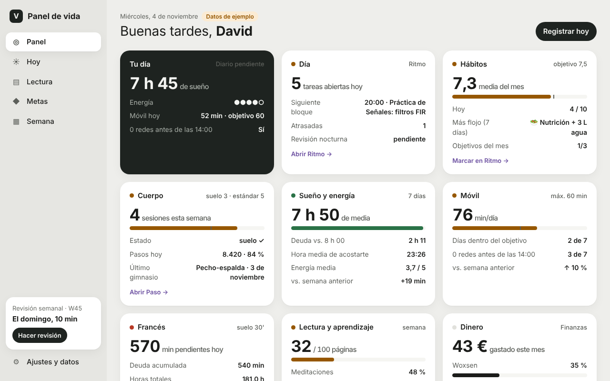
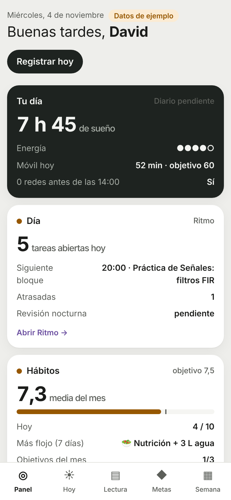

# 28 · Panel de vida

## Qué es
La portada de todas tus apps: **tu vida en una pantalla**, por áreas de tus visiones, con semáforo. Además trae lo que faltaba por medir:

| Sección | Qué haces ahí | Qué te devuelve |
|---|---|---|
| **Panel** | Mirar (30 s al día) | Tarjetas de Día (Ritmo), Hábitos, Cuerpo (deporte suelo 3 / estándar 5, pasos, gimnasio), Sueño y energía, Móvil, Francés, Lectura, Dinero, Metas y cuenta atrás (Woxsen, media maratón, prácticas, Ironman), más los accesos a tus 8 apps |
| **Hoy** | Apuntar sueño (me acosté / me levanté), energía 1-5, minutos de móvil y «0 redes antes de las 14:00», **diario de 3 líneas** y el avance de lectura | Horas dormidas, racha de diario, últimos 7 días |
| **Lectura** | Añadir libros (páginas) y cursos (lecciones) | Páginas de la semana frente a tu objetivo, % de cada libro y **cuándo lo acabas** a tu ritmo de 2 semanas |
| **Metas** | Metas con número («llevo X de Y») o hitos con pasos, con fecha | Barra de progreso + **marca de dónde deberías ir** → «En ritmo» / «Atrasada». Algunas se calculan solas desde tus apps |
| **Semana** | El domingo, 10 min: nota 1-10, 3 victorias, 1 lección, 3 prioridades | Foto automática de la semana de **todas** tus apps con semáforos + tu diario de la semana. Las prioridades salen luego en el Panel |
| **Ajustes** | Tus objetivos (sueño 8 h, acostarte 23:30, móvil 60 min, 100 páginas/semana, 180 min de cursos) | **Copia de seguridad de las 9 apps en un solo fichero** y restauración |




## Cómo usarlo
- **Doble clic en `index.html`** (o en el `index.html` de la raíz del repo, que redirige aquí). Mejor aún, en GitHub Pages: `https://davidcormar.github.io/Mix_ideas/` → en Safari, Compartir → «Añadir a pantalla de inicio».
- **Primera vez:** ya vienen 6 metas sacadas de tus visiones (5K < 26:00, suelo de deporte, horas de francés al B2, media de hábitos, 12 libros, preparar Woxsen). En *Ajustes* puedes «Cargar datos de ejemplo» para verlo lleno (solo toca el Panel) y luego quitarlos.
- **Rutina sugerida:**
  - Por la mañana (1 min): *Hoy* → hora de acostarte y levantarte + energía.
  - Por la noche (2 min): minutos de móvil (iPhone: *Ajustes → Tiempo de uso*), diario de 3 líneas y páginas leídas. Encaja justo antes de la revisión nocturna de Ritmo.
  - Domingo (10 min): *Semana* → revisión + **descargar la copia de seguridad**.
- **Lectura entre apps:** el Panel lee tus otras apps solo si comparten origen: GitHub Pages, o Chrome/Edge en local. Firefox con doble clic aísla cada fichero.

Tests (desde `28-panel-vida/`):
```bash
node --test tests/*.test.js                      # 12 tests de lógica
NODE_PATH=$(npm root -g) node tests/smoke.js     # recorrido completo en Chromium + capturas
```

## Qué está hecho
- ✅ Panel con 10 tarjetas y semáforos, leyendo Ritmo, Hábitos, Gym, Paso, Idiomas y Finanzas (solo lectura).
- ✅ Registro diario: sueño (cruza medianoche), energía, móvil, 0 redes por la mañana, diario de 3 líneas que se guarda solo, avance de lectura.
- ✅ Lectura y cursos con previsión de fin; metas con progreso esperado y cálculo automático; revisión semanal con foto de todas las apps.
- ✅ Copia de seguridad única de las 9 apps (exportar / restaurar con confirmación; una copia inválida no cambia nada).
- ✅ Modo oscuro, móvil desde 360 px sin scroll horizontal, datos dañados con descarga del texto, 12 tests + smoke test.

## Qué falta / siguientes pasos
- Gráficas de tendencia de varias semanas (sueño y móvil) y correlaciones más finas (p. ej. móvil ↔ sueño).
- Importar el tiempo de pantalla y el sueño directamente de Apple Health (Paso ya sabe leer `export.xml`).
- Restaurar la copia **fusionando** en vez de sustituir app por app.
- Editar las fechas de la cuenta atrás desde Ajustes (ahora están en `logic.js`, `COUNTDOWNS`).

## Decisiones
- **Una sola app, no seis.** Sueño, lectura, diario, metas, revisión y móvil son secciones del Panel: menos sitios donde apuntar y una sola copia de seguridad.
- **Solo escribe `panel.v1`.** Las demás apps se leen con los mismos lectores de Ritmo (`../26-ritmo/logic.js`) e Idiomas (`../21-idiomas-plan/logic.js`), así los números coinciden en todas partes (deporte: `max(hábito, gimnasio + carreras, tareas de Ritmo)` por día, sin contar dos veces). La única excepción es «Restaurar copia», que pide confirmación y dice qué apps sustituye.
- **El Panel no marca hábitos.** Los ticks los pone Ritmo o Hábitos; así hay un único escritor de `habitos.v1` además de la propia app 15.
- **Sueño:** la noche cuenta en el día en que te levantas. Más de 16 h se descarta como error. La hora media de acostarse se calcula desde el mediodía, para que 23:30 y 00:30 queden cerca. Objetivo por defecto 8 h (las recomendaciones generales para adultos jóvenes están entre 7 y 9 h; es información general, no consejo médico).
- **Energía y sueño:** si hay al menos 2 noches «largas» y 2 «cortas», el resumen compara tu energía media en ambas (te dirá si te compensa acostarte antes).
- **Móvil:** se apunta a mano en minutos (el iPhone no deja leer Tiempo de uso desde una web). Objetivo 60 min, como tu hábito «Móvil (0 redes <14:00, máx 1 h)».
- **Metas:** «en ritmo» si vas como mucho 10 puntos por detrás de lo esperado con avance lineal entre «Desde» y la fecha límite. Las automáticas cuentan **desde la fecha «Desde» de la meta**, no desde el 1 de enero, para que una meta nueva no nazca atrasada.
- **Revisión semanal:** semana ISO de lunes a domingo; se guarda con una foto de los números para poder comparar semanas aunque luego cambien los datos de otras apps.
- **Fechas** siempre locales (nunca `toISOString` para el día); la cuenta atrás de prácticas e Ironman es aproximada.
- Sin frameworks, sin CDN, sin módulos: abre con doble clic.
